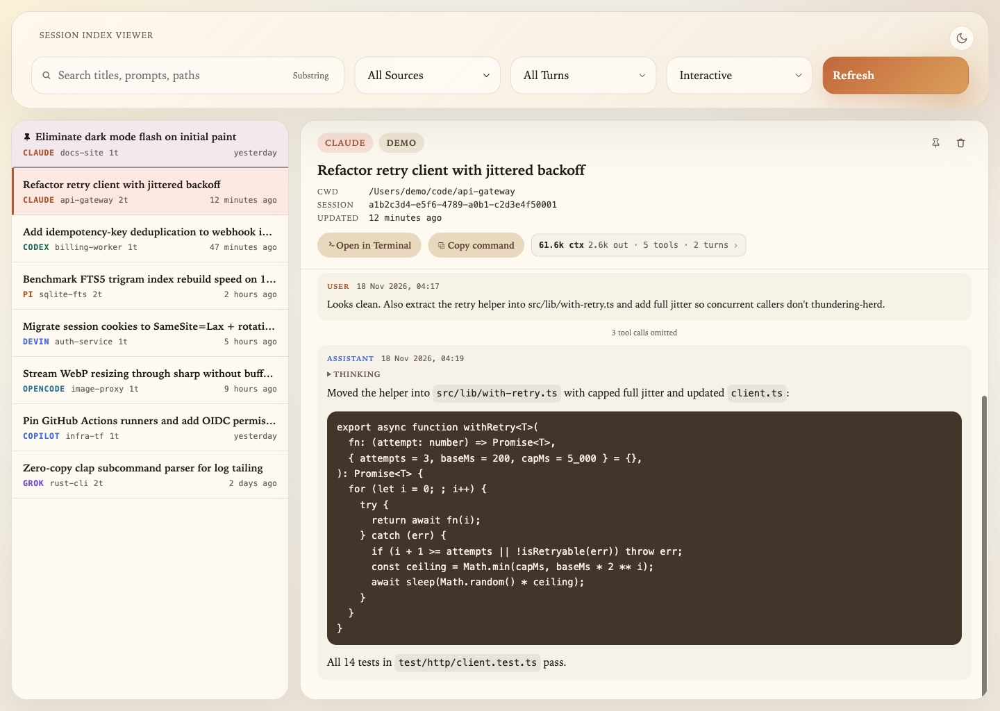

# session-index-viewer

**English** · [简体中文](README.zh-CN.md)

Local web viewer for **Claude Code**, **Codex**, **Devin**, **Grok**, **Pi**, **Copilot CLI**, and **opencode** sessions.

<p align="center">
  
</p>

## Run

```bash
./install.sh            # macOS: build frontend (bun or npm) + start launchd agent
open http://localhost:7333
```

- **Foreground** (macOS / Windows): `python3 server.py` (`python server.py` on Windows; binds `127.0.0.1:7333`).
- **Rebuild frontend**: `cd frontend && bun run build`.
- **Uninstall** (macOS `launchd` agent, plist, and logs): `./uninstall.sh`.
- **Resume terminal**: macOS opens **Ghostty** (new tab on ≥ 1.3), **iTerm**, or **Terminal.app** in that order; Windows opens **PowerShell** (`pwsh` 7 when installed).

## Keyboard

| Key | Action |
|-----|--------|
| `j` / `k` or `↓` / `↑` | Select session |
| `Enter` | Resume in terminal |
| `c` | Copy resume command |
| `p` | Pin / unpin |
| `u` | Usage details |
| `x` | Move session (or marked set) to Trash / Recycle Bin |
| `m` / `⌘`-click | Mark for bulk delete |
| `n` / `N` | Next / previous search match |
| `Esc` | Clear marks / close mobile detail pane |
| `⌘K` / `Ctrl+K` | Jump to session |

## Sources

| Source | Default path | Resume | Token / Context notes |
|--------|--------------|--------|-----------------------|
| Claude Code | `~/.claude/projects/*/*.jsonl` | `claude --resume <id>` | Sums assistant `message.usage`; context ≈ peak input+cache |
| Codex | `~/.codex/sessions/**/rollout-*.jsonl` | `codex resume <id>` | Last cumulative `token_count`; context ≈ peak turn total |
| Devin | `~/.local/share/devin/cli/sessions.db` (`%APPDATA%\devin\cli\sessions.db` on Windows) | `devin -r <id>` | Sums `message_nodes`; context ≈ peak assistant `input_tokens` |
| Grok | `$GROK_HOME/sessions` (`~/.grok/sessions`) | `grok --resume <id>` | Context size only (`signals.json`) |
| Pi | `~/.pi/agent/sessions/*/*.jsonl` | `pi --session <id>` | Sums assistant `message.usage`; context ≈ peak turn total |
| Copilot CLI | `~/.copilot/session-store.db` | `copilot --resume <id>` | Sums `assistant_usage_events`; context ≈ peak input |
| opencode | `~/.local/share/opencode/opencode.db` | `opencode --session <id>` | Session token sums; context ≈ peak assistant message total |

## Notes

- **Search**: Matches whole words by default (CJK fragments always match); toggle **Substring** to match inside Latin words, or wrap `"double quotes"` for an exact phrase. `Thinking` blocks are excluded. Index cache lives at `~/.cache/session-index-viewer/index.db` and rebuilds if deleted.
- **Deletion**: File-backed sources move directly to `~/.Trash` (or the Windows Recycle Bin). SQLite-backed sources (Devin, Copilot, opencode) archive a JSON row dump there before deleting DB rows.
- **Headless**: Non-interactive runs (`-p`, `exec`, ACP/MCP, subagents) are hidden by default under `Interactive`; Pi `-p` runs write the same JSONL as the TUI and cannot be distinguished.
- **Syncing across machines**: Per-file stores (`~/.claude/projects`, `~/.codex/sessions`, `~/.pi/agent/sessions`, and `~/.grok/sessions` excluding `session_search.sqlite` / `*.lock`) sync cleanly via Syncthing; single-file SQLite stores do not. Foreign `/Users/<name>`, `/home/<name>`, or `C:\Users\<name>` prefixes in `cwd` show a host badge and remap to your local home directory on resume.
