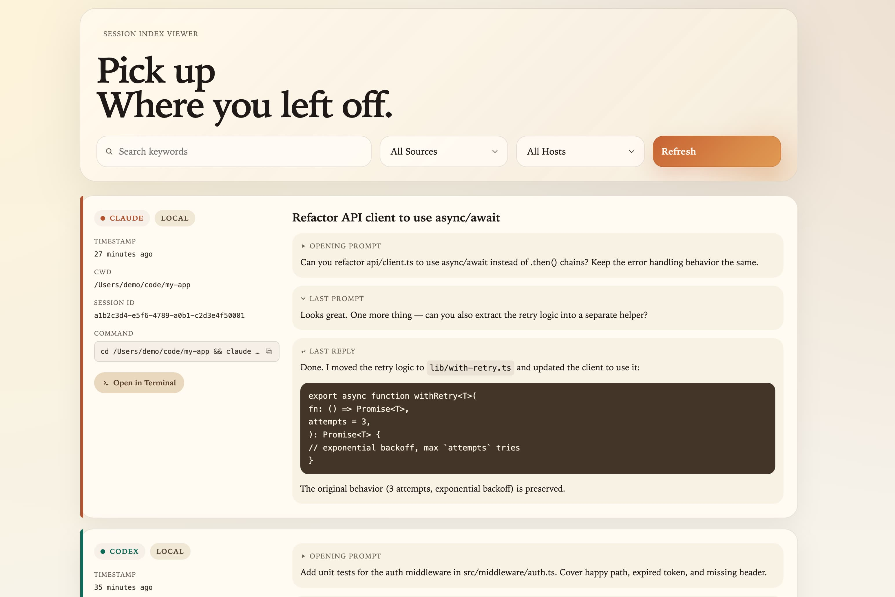

# session-index-viewer

**English** · [简体中文](README.zh-CN.md)

Local web viewer for AI coding CLI sessions on this machine. Browse
sessions from **Claude Code**, **Codex**, **Devin**, **Grok**, **Pi**,
**Copilot CLI**, and **opencode** in one place,
search across tools, inspect token/tool usage when metadata exists, and resume
any session in a new Terminal window with a single click.

<p align="center">
  
</p>

CLI resume lists (`claude --resume`, `codex resume`, `grok --resume`, …) show
ids and timestamps — not what was said. This viewer shows the opening prompt
and last reply of every session so you can spot the one you want and pick up
where you left off.

A **dark mode** toggle sits in the hero's top-right corner. The choice
persists across reloads and defaults to the OS `prefers-color-scheme`
on first visit.

> **macOS only.** Uses launchd for autostart and AppleScript /
> `open -na` to launch Ghostty, iTerm, or Terminal.app. Auto-detects
> whichever is installed, in that order.

## Run

```bash
./install.sh            # install as launchd agent (run at login, keep alive)
open http://localhost:7333
```

Or run in the foreground: `python3 server.py`.

Frontend (optional rebuild after UI changes):

```bash
cd frontend && npm install && npm run build
```

`server.py` serves `frontend/dist/` when present, otherwise
`sessions-index.html`.

## Supported sources

| Source | Default path | Resume | Usage notes |
|--------|--------------|--------|-------------|
| Claude Code | `~/.claude/projects/*/*.jsonl` | `claude --resume <id>` | Lifetime sums from assistant `message.usage`; context ≈ peak input+cache |
| Codex | `~/.codex/sessions/**/rollout-*.jsonl` | `codex resume <id>` | Last cumulative `token_count`; context ≈ max per-turn total |
| Devin | `~/.local/share/devin/cli/sessions.db` | `devin -r <id>` | Aggregated from `message_nodes` |
| Grok | `$GROK_HOME/sessions` (default `~/.grok/sessions`) | `grok --resume <id>` | **Context size only** on disk (`signals.json`) |
| Pi | `~/.pi/agent/sessions/*/*.jsonl` | `pi --session <id>` | Sums each assistant turn's `message.usage`; context ≈ largest per-turn total |
| Copilot CLI | `~/.copilot/session-store.db` | `copilot --resume <id>` | Sums per-turn `assistant_usage_events`; context ≈ peak input tokens |
| opencode | `~/.local/share/opencode/opencode.db` | `opencode --session <id>` | Cumulative `session` token sums; context ≈ largest assistant message total |

Usage in the detail pane is a short chip (`ctx · out · tools · turns`). Click
it (or press **`u`**) for a modal with overview KPIs, token mix,
activity counts, a **context pressure bar** (peak context vs. the model's
window limit, colour-coded green / yellow / red), and a short note on how
that source measures tokens.

**Context** is peak / window occupancy — not a full-session billing total.
Grok often only has that size signal (labelled **size only** on the chip).

## Layout

The left pane lists sessions, pinned first, then newest first. The right
pane shows the active session: resume and copy actions, usage, and the
conversation. The conversation shows your prompts and the agent's replies;
tool calls are only counted. It opens at the newest messages, and
**Load earlier** pages back. On narrow screens the list fills the window
and the conversation slides over it.

## Search

Typing filters by title, first and last prompt, cwd and session id, using
the whole query as one string. A moment after you stop typing, the query
also runs against the text of every conversation. There each word is
matched separately, and all of them must appear in the same message;
`"double quotes"` keep a phrase together. Sessions that match only in
their conversation join the list with a hit count. Results stay in time
order. Chinese, Japanese and code fragments all match.

In the conversation, matches are highlighted and `n` / `N` step through
them. Matches in messages not loaded yet are counted, with a link to load
them.

The search index is kept in `~/.cache/session-index-viewer/` and built in
the background on first start; until it is ready, a note says results may
be incomplete. Deleting it is safe; it is rebuilt.

## Keyboard

| Key | Action |
|-----|--------|
| `j` / `k` or arrows | Move the active session (the detail pane follows) |
| `Enter` | Resume in Terminal |
| `c` | Copy resume command (not ⌘C — system copy still works) |
| `p` | Pin / unpin |
| `u` | Open usage modal (when usage exists) |
| `x` | Delete session (moves data to Trash, confirmed first) |
| `m` / ⌘-click | Mark for bulk delete; `x` then deletes the marked set |
| `n` / `N` | Next / previous search match in the detail pane |
| `Esc` | Clear marks; on narrow screens, close the detail pane |
| `⌘K` / `Ctrl+K` | Command palette |

## Headless sessions

A session is **headless** when nobody could reply in it: `-p` and exec
runs, ACP or MCP drivers, and subagents, whether a script or another agent
started them. They are marked `headless` and hidden by default; the
toolbar's origin filter shows them. `Headless Only` plus bulk delete
clears them out.

| Source | Signal |
|--------|--------|
| Claude Code | Every record's `entrypoint` is `sdk-*` (`sdk-cli` = `claude -p`); a later TUI turn makes it interactive |
| Codex | `session_meta.originator` is `codex_exec`, `acpx` or `codex_cli_rs`, or `source` is a subagent (guardian approval reviews, spawned worker threads) |
| Devin | No typed message carries `chisel/client-message-id`. Older Devin builds never wrote it, so sessions from those builds are never flagged |
| Copilot CLI | The system prompt in `session-state/<id>/events.jsonl` says "running in non-interactive mode" |
| opencode | `opencode run` (`permission` denies `question`) or a subagent (`parent_id` set) |
| Grok | `prompt_context.json` has `is_non_interactive: true` |
| Pi | Not detectable: `pi -p` writes the same JSONL as the TUI |

## Deleting sessions

The trash button in the detail pane's header (or `x`) asks for
confirmation, then removes the session **via `~/.Trash`** — file-backed
sources (Claude, Codex, Pi, Grok) are moved wholesale; database-backed
sources (Devin, Copilot, opencode) get a JSON dump of the session's rows
written to Trash before the rows are removed. Deletion is disabled when
`~/.Trash` doesn't exist. A **Turns** filter in the toolbar (`≤ 1/2/3`)
surfaces low-activity sessions — e.g. one-shot "reply with just: ok"
noise — for quick pruning.

## Pieces

- `server.py` — thin entry point (`python3 server.py` / launchd).
- `siv/` — stdlib-only backend on `127.0.0.1:7333`:
  - `GET /` serves the viewer.
  - `GET /api/sessions` scans session files live, with an mtime/size
    cache so only changed files are re-parsed.
  - `GET /api/session` returns one page of a session's conversation.
  - `GET /api/search` returns full-text hits per session.
  - `POST /api/resume` opens a Terminal window with a validated
    `cd <cwd> && <tool> resume <id>` command. If the recorded cwd belongs
    to another machine, the home-dir prefix is remapped to this machine.
  - Host badges come from the username in each session’s cwd
    (`/Users/<name>/...` or `/home/<name>/...`).
  - Parsers: `siv/sources/` (`claude`, `codex`, `devin`, `grok`, `pi`,
    `copilot`, `opencode`).
- `frontend/` — React two-pane UI (session list, conversation pane, search and
  filters, pin, usage modal, light/dark theme toggle).
- `sessions-index.html` — legacy single-file viewer (fallback if dist is missing).
- `install.sh` — launchd plist + optional frontend build. Logs:
  `~/Library/Logs/session-index-viewer.log`.
- `index-sessions.sh` — legacy shell indexer; superseded by `server.py`.

## Multi-machine setup

If you sync session trees with Syncthing (or similar):

| Path | Sync-friendly? |
|------|----------------|
| `~/.claude/projects` | Yes (per-file jsonl) |
| `~/.codex/sessions` | Yes (per-file jsonl) |
| `~/.grok/sessions` | Yes if you sync only session dirs and ignore `session_search.sqlite` / `*.lock` |
| `~/.pi/agent/sessions` | Yes (per-file jsonl) |
| Devin `sessions.db` | **No** — single SQLite DB does not merge across machines |
| Copilot `session-store.db` | **No** — single SQLite DB does not merge across machines |
| opencode `opencode.db` | **No** — single SQLite DB does not merge across machines |

No extra viewer config is required: each session is labelled by the username
in its recorded cwd, and the host filter picks those labels up. Sessions that
share a username across machines appear under the same host.

Avoid writing the same session id on two machines at once (conflict copies).
