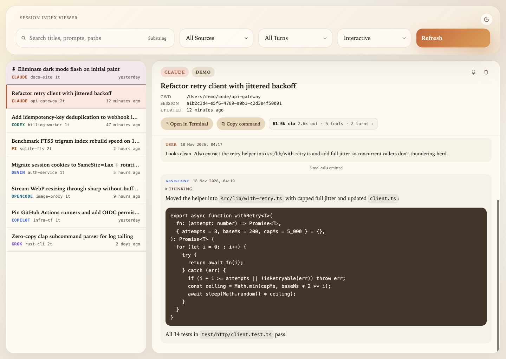

# session-index-viewer

[English](README.md) · **简体中文**

本地浏览与恢复 **Claude Code**、**Codex**、**Devin**、**Grok**、**Pi**、**Copilot CLI**、**opencode** 会话的小工具。

<p align="center">
  
</p>

## 运行与卸载

```bash
./install.sh            # macOS：构建前端（bun 或 npm）并注册 launchd 自启
open http://localhost:7333
```

- **前台运行**（macOS / Windows）：`python3 server.py`（Windows 用 `python server.py`，监听 `127.0.0.1:7333`）。
- **重建前端**：`cd frontend && bun run build`。
- **卸载服务**（移除 macOS `launchd` 配置与日志）：`./uninstall.sh`。
- **恢复终端**：macOS 按 **Ghostty**（≥ 1.3 在现有实例新建标签页）、**iTerm**、**Terminal.app** 顺序自动检测；Windows 新开 **PowerShell**（优先 `pwsh` 7）。

## 快捷键

| 键 | 作用 |
|----|------|
| `j` / `k` 或 `↓` / `↑` | 切换会话 |
| `Enter` | 在终端恢复 |
| `c` | 复制恢复命令 |
| `p` | 置顶 / 取消置顶 |
| `u` | 用量详情 |
| `x` | 移入 `~/.Trash` 或回收站（支持标记项批量删除） |
| `m` / `⌘` + 点击 | 标记待批量删除 |
| `n` / `N` | 下一个 / 上一个搜索命中 |
| `Esc` | 清除标记 / 窄屏关闭详情 |
| `⌘K` / `Ctrl+K` | 快速跳转 |

## 支持的来源

| 来源 | 默认路径 | Resume | 用量口径 |
|------|----------|--------|----------|
| Claude Code | `~/.claude/projects/*/*.jsonl` | `claude --resume <id>` | 累加 assistant `message.usage`；Context ≈ 单轮 input+cache 峰值 |
| Codex | `~/.codex/sessions/**/rollout-*.jsonl` | `codex resume <id>` | 最后一次累计 `token_count`；Context ≈ 单轮 total 峰值 |
| Devin | `~/.local/share/devin/cli/sessions.db`（Windows：`%APPDATA%\devin\cli\sessions.db`） | `devin -r <id>` | 聚合 `message_nodes`；Context ≈ 单轮 assistant `input_tokens` 峰值 |
| Grok | `$GROK_HOME/sessions`（`~/.grok/sessions`） | `grok --resume <id>` | 仅记录当前上下文占用（`signals.json`） |
| Pi | `~/.pi/agent/sessions/*/*.jsonl` | `pi --session <id>` | 累加 assistant `message.usage`；Context ≈ 单轮 total 峰值 |
| Copilot CLI | `~/.copilot/session-store.db` | `copilot --resume <id>` | 累加 `assistant_usage_events`；Context ≈ 单轮 input 峰值 |
| opencode | `~/.local/share/opencode/opencode.db` | `opencode --session <id>` | 取 `session` 累计汇总；Context ≈ 单条 assistant 消息 total 峰值 |

## 补充说明

- **搜索**：英文默认按完整单词匹配（中日文仍支持片段匹配）；开启 **Substring** 可匹配单词内部子串，用 `"双引号"` 匹配完整短语（不含 `Thinking` 内容）。索引缓存在 `~/.cache/session-index-viewer/index.db`，删除后自动重建。
- **删除**：文件类来源直接移入 `~/.Trash`（Windows 为回收站）；SQLite 来源（Devin、Copilot、opencode）先将会话记录导出为 JSON 存档放入废纸篓/回收站，再删库中行。
- **Headless**：非交互会话（`-p`、`exec`、ACP/MCP、subagent）在默认 `Interactive` 筛选下隐藏；Pi 的 `-p` 与 TUI 落盘格式相同，无法区分。
- **多机同步**：按文件拆分的目录（`~/.claude/projects`、`~/.codex/sessions`、`~/.pi/agent/sessions`，以及排除 `session_search.sqlite` / `*.lock` 后的 `~/.grok/sessions`）可用 Syncthing 同步；单库 SQLite 来源不支持多机合并。来自其他机器 `/Users/<name>`、`/home/<name>` 或 `C:\Users\<name>` 的路径会自动显示 host 标签，并在恢复时映射回本机 home 目录。
